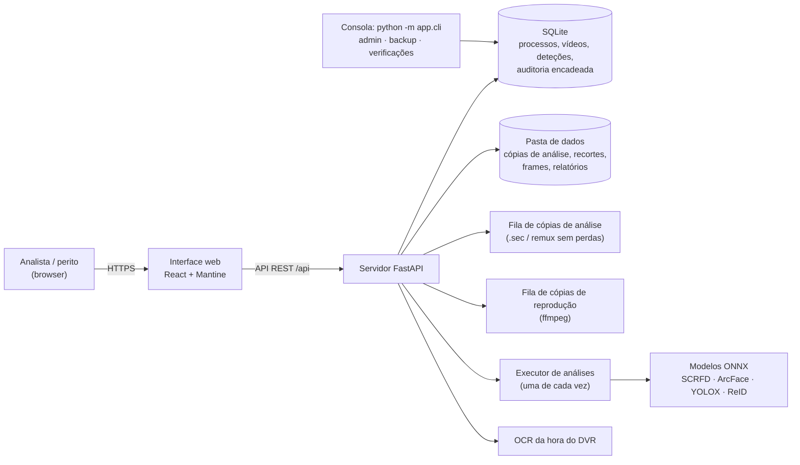
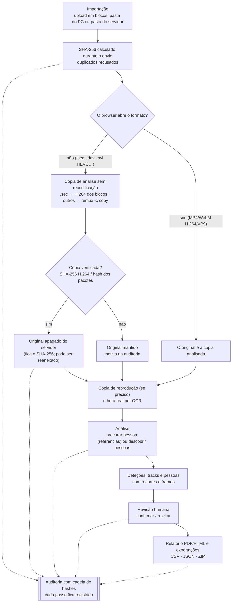

# FaceAI — deteção de uma pessoa em vídeos de CCTV

Aplicação web local para apoio à investigação forense digital. A partir de uma ou mais **imagens de referência** da face de uma pessoa, analisa **vídeos de CCTV** importados e indica **se** essa pessoa aparece, **quando** (timestamps e intervalos) e **com que grau de semelhança**.

Inclui ainda:
- **modo descoberta**, para quando não há amostra: todas as faces são detetadas e agrupadas em **pessoas distintas**, e qualquer uma pode depois servir de amostra;
- tracking de faces e revisão humana dos resultados (por pessoa, por track ou por deteção);
- **download do frame** de cada deteção, com marcação (JPEG) ou **original sem marcação** (PNG extraído do vídeo), registado na auditoria com SHA-256;
- **hora real** do CCTV, por OCR da data/hora gravada na imagem, acerto manual e desvio do relógio do DVR;
- score de qualidade de cada face;
- relatório PDF/HTML e exportação CSV/JSON/ZIP;
- log de auditoria;
- upload em blocos com retoma.

> ⚠️ Os resultados de reconhecimento facial são **indicativos**. Não constituem identificação conclusiva e têm de ser validados por um perito.

---

---

## Início rápido (Docker)

```bash
git clone https://github.com/miguelsilv6/FaceAI.git && cd FaceAI
cp .env.example .env          # opcional: MFA obrigatório, Cloudflare, limite de CPU…
docker compose up -d --build  # GPU NVIDIA: docker compose --profile gpu up -d --build faceai-gpu
```

1. Abra **http://localhost:8000**.
2. No primeiro acesso, crie o administrador. O **código de configuração** está em `./data/setup-code.txt` (ou em `docker compose logs faceai`).
3. Em *Utilizadores*, crie as contas dos analistas.

Instalação nativa, GPU, posto offline e Cloudflare Tunnel: [docs/INSTALACAO.md](docs/INSTALACAO.md).

## Como se usa

Cada processo segue a ordem dos separadores. O **Resumo** mostra os primeiros passos até estarem feitos.

1. **Pessoas:** fotos da pessoa a procurar. Sem fotos, use "Descobrir pessoas".
2. **Vídeos:** importe os vídeos de CCTV, organizados por local. Pode importar pastas inteiras; o SHA-256 é calculado na importação.
3. **Análises:** escolha o modo, os locais, as pessoas e o rigor (Rápida, Equilibrada ou Minuciosa). Pode sair da página enquanto a análise corre.
4. **Resultados:** reveja as aparições (confirmar ou rejeitar), guarde frames e exporte o relatório PDF.

Passo a passo, com dicas: [docs/GUIA-UTILIZADOR.md](docs/GUIA-UTILIZADOR.md).

## Visão geral

### Arquitetura



### Percurso de um vídeo (da importação ao relatório)



Princípios forenses do percurso:
- **A análise nunca usa uma cópia recodificada.** Usa o original ou uma cópia com os mesmos pacotes de vídeo, verificada por hash. A cópia de reprodução serve só para ver no browser.
- **Tudo fica registado na auditoria.** Cada importação, conversão, remoção de original, análise, revisão e exportação deixa um evento. A auditoria é uma cadeia de hashes que deteta alterações (`python -m app.cli verify-audit`).
- **A integridade pode ser reconfirmada a qualquer momento.** O SHA-256 dos vídeos é recalculado no relatório e na verificação de evidência (`verify-evidence`).

## Documentação

| Documento | Para quem | Conteúdo |
|---|---|---|
| [Guia do utilizador](docs/GUIA-UTILIZADOR.md) | analistas | o trabalho num processo, do início ao relatório |
| [Instalação](docs/INSTALACAO.md) | quem instala | requisitos, Docker, instalação nativa, GPU, offline, Cloudflare |
| [Operação](docs/OPERACAO.md) | administradores | backups e restauro, atualizações, consola (`app.cli`), registos |
| [Documentação técnica](docs/TECNICO.md) | peritos e programadores | reconhecimento, configuração completa, segurança, `.sec`, armazenamento, considerações forenses |

## Desenvolvimento

```bash
python3 -m venv .venv && source .venv/bin/activate
pip install -e "backend[cpu,dev]"
cd backend && uvicorn app.main:app --reload --port 8000   # e, noutro terminal:
cd frontend && npm install && npm run dev                 # http://localhost:5173
```

Testes: `cd backend && ruff check . && pytest` (motor facial simulado, sem modelos) e `cd frontend && npm run build`. A CI corre os três em cada push e PR.
