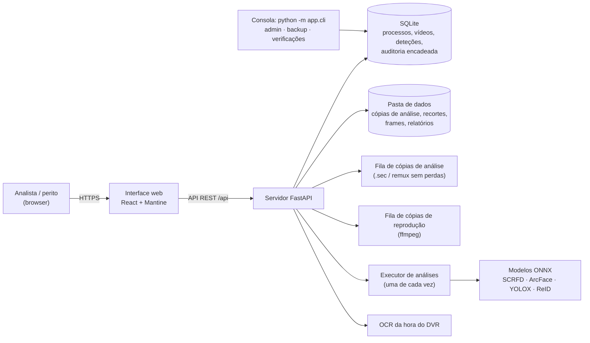
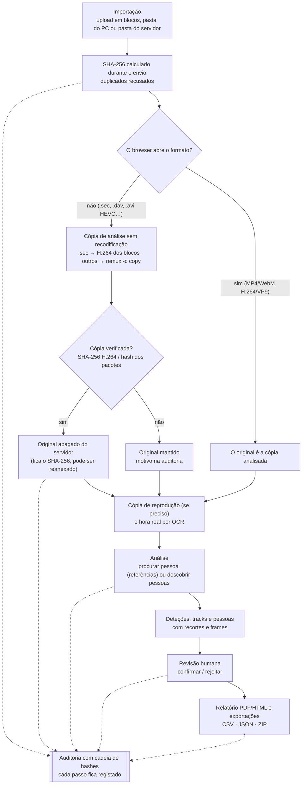

# FaceAI — deteção de uma pessoa em vídeos de CCTV

Aplicação web local para apoio à investigação forense digital. A partir de uma ou mais **imagens de referência** da face de uma pessoa, analisa **vídeos de CCTV** importados e indica **se** essa pessoa aparece, **quando** (timestamps e intervalos) e **com que grau de semelhança**.

Inclui ainda:
- **modo descoberta**, para quando não há amostra: todas as faces são detetadas e agrupadas em **pessoas distintas**, e qualquer uma pode depois servir de amostra;
- tracking de faces e revisão humana dos resultados (por pessoa, por track ou por deteção);
- **download do frame** de cada deteção, com marcação (JPEG) ou **original sem marcação** (PNG extraído do vídeo), registado na auditoria com SHA-256;
- **hora real** do CCTV, por OCR da data/hora gravada na imagem, acerto manual e desvio do relógio do DVR;
- score de qualidade de cada face;
- relatório PDF/HTML e exportação CSV/JSON/ZIP;
- log de auditoria;
- upload em blocos com retoma.

> ⚠️ Os resultados de reconhecimento facial são **indicativos**. Não constituem identificação conclusiva e têm de ser validados por um perito.

---

## Soluções open source usadas (e alternativas)

| Camada | Escolha | Alternativas consideradas |
|---|---|---|
| Runtime de inferência | **ONNX Runtime** (CPU, ou GPU NVIDIA com `onnxruntime-gpu`) | TensorFlow (motor DeepFace, opcional), PyTorch |
| Deteção facial | **SCRFD-10G** (InsightFace), com **SCRFD-500M** como 1.ª passagem rápida | RetinaFace, YuNet, MTCNN, YOLOv8-face |
| Reconhecimento (embeddings) | **ArcFace ResNet-50 / MobileFaceNet**, treinados no WebFace600K (InsightFace `buffalo_l` / `buffalo_sc`) | Facenet512, VGG-Face (via DeepFace) |
| Motor alternativo | **[DeepFace](https://github.com/serengil/deepface)** (MIT), com `FACEAI_ENGINE=deepface` | CompreFace, facenet-pytorch |
| Vídeo | **OpenCV** (amostragem, pré-filtro de movimento) + **ffmpeg** (cópia de reprodução) | PyAV, decord |
| Comparação / tracking | Distância de cosseno em NumPy; tracker IoU + embedding | FAISS; ByteTrack/DeepSORT |
| Vestuário (complemento) | **YOLOX** (deteção de pessoas, Apache-2.0) + **OSNet-AIN x1.0** treinado no MSMT17 (ReID, torchreid, MIT) + histogramas de cor HSV | YOLOv8 (AGPL), FastReID, CLIP-ReID |
| Backend | **FastAPI** + SQLModel/SQLite | Flask, Django |
| Frontend | **React + Vite + Mantine** | Gradio/Streamlit, PySide6 |
| Relatórios | **Jinja2 + WeasyPrint** | ReportLab |

---

## Visão geral

### Arquitetura



### Percurso de um vídeo (da importação ao relatório)



Princípios forenses do percurso:
- **A análise nunca usa uma cópia recodificada.** Usa o original ou uma cópia com os mesmos pacotes de vídeo, verificada por hash. A cópia de reprodução serve só para ver no browser.
- **Tudo fica registado na auditoria.** Cada importação, conversão, remoção de original, análise, revisão e exportação deixa um evento. A auditoria é uma cadeia de hashes que deteta alterações (`python -m app.cli verify-audit`).
- **A integridade pode ser reconfirmada a qualquer momento.** O SHA-256 dos vídeos é recalculado no relatório e na verificação de evidência (`verify-evidence`).

## Como funciona (reconhecimento)

```
Referências ──► SCRFD ──► alinhamento (5 pontos) ──► ArcFace (512-d) ─────────────────────────┐
                                                                                              ▼
Vídeo ─► frames a N fps ─► [1] filtro de movimento ─► [2] SCRFD-500M rápido ─► [3] SCRFD-10G + ArcFace
                             (saltar se estático)       (saltar se sem faces)            │
                                                                                         ▼
                 [4] qualidade da face ─► [5] tracking ─► distância de cosseno às referências
                                                                                         │
           segmentos de aparição ◄── tracks / deteções com match ◄── revisão humana ◄────┘
```

1. **Referências.** Cada imagem tem de conter **exatamente uma face**. As imagens com 0 ou mais de 1 face ficam marcadas como inválidas. Ter várias imagens (ângulos, iluminação, idades diferentes) aumenta a sensibilidade.
2. **Pré-filtro de movimento.** Cada frame amostrado é comparado, numa versão pequena e desfocada, com o último frame analisado. Se a imagem não mudou (por omissão, menos de 0,2 % dos píxeis), o frame é saltado. Um *frame-chave* periódico (5 s) garante que cenas paradas continuam a ser verificadas. Quando um frame é saltado por ser idêntico, as faces do último frame analisado continuam presentes, por isso o track de alguém parado mantém a duração correta.
3. **Cascata de deteção.** O SCRFD-500M (~13 ms/frame) verifica primeiro se há faces. O detetor principal e o reconhecimento só correm nos frames com faces.
4. **Comparação.** Cada face é alinhada com 5 pontos, convertida num embedding ArcFace e comparada com todas as referências; conta a menor distância de cosseno. Há **match** quando `distância ≤ limiar`. O limiar por omissão é 0,65, calibrado com 300 pares rotulados: mesma pessoa até 0,45; pessoas diferentes a partir de 0,78.
5. **Qualidade da face (0–100).** É a média geométrica de três componentes: **nitidez** (variância do Laplaciano), **tamanho** e **frontalidade** (posição do nariz face aos olhos). Serve para ordenar e filtrar deteções, e para explicar porque um match é fraco.
6. **Tracking.** As deteções da mesma face em frames consecutivos são agrupadas num *track*, por semelhança do embedding e sobreposição das caixas. O match do track decide-se pela **média das 3 melhores distâncias**, mais robusta do que frames isolados. Depois de um track ter uma correspondência, os frames seguintes da mesma face também são guardados, mesmo os de perfil ou desfocados, o que dá ao perito a trajetória completa. **Na revisão, um track inteiro confirma-se ou rejeita-se de uma vez.** As deteções, tracks e pessoas rejeitadas ficam **ocultas** nos resultados (com **Anular** logo a seguir e o interruptor **Mostrar rejeitadas** para as voltar a ver). Não são apagadas: a revisão fica na base de dados e na auditoria, e as rejeitadas já não entram nos segmentos, no percurso nem no relatório.
7. **Hora real.** Ver a secção [Hora real do CCTV](#hora-real-do-cctv).
8. **Segmentos e prova.** Os tracks e as deteções com match formam os intervalos de aparição. Por cada deteção ficam guardados: recorte da face, timestamp, nº de frame, caixa, confiança, distância, qualidade e track. O **frame anotado é gerado a pedido** a partir do vídeo (ver [Armazenamento](#armazenamento)).

### Desempenho (CPU, 4 vCPU)

| | DeepFace (versão anterior) | ONNX (atual) |
|---|---|---|
| Deteção + reconhecimento, por frame | ~1,6 s | ~0,07 s de deteção + ~0,08 s por face (R50); ~0,01 s por face com MobileFaceNet |
| Vídeo de teste de 20 s, 5 fps, 3 pessoas | — | 28,5 s sem filtros → **3,6 s** com movimento + cascata + tracking, com os **mesmos segmentos** |
| RAM | ~1,4 GB | ~0,56 GB |
| Instalação | ~2,8 GB (TensorFlow) | ~0,5 GB + 198 MB de modelos |

Em CCTV real, o ganho do pré-filtro depende do movimento na cena: quanto mais estática a câmara, maior.

**Análise (pipeline):**
- **Medição por fase:** cada análise guarda o tempo de cada fase em `job.environment["timings"]` (descodificação, movimento, cascata, deteção, gravação, base de dados), com o total e os frames/s. O benchmark `tools/bench_pipeline.py` usa um vídeo sintético tipo CCTV com relógio sobreposto e confirma que uma otimização não muda os resultados (`--compare`).
- **Descodificação:** corre numa thread própria, com 4 frames de avanço e exatamente os mesmos frames. Com o SCRFD real num vídeo de 640×360, a análise passou de 11,8 para 12,5 frames/s; em resoluções maiores, onde descodificar custa mais, o ganho cresce.
- **Recortes:** gravados num pool de 2 threads. Antes de cada commit espera-se que estejam no disco, por isso nenhuma deteção fica registada sem os seus ficheiros. O frame anotado já não é gravado na análise.
- **Faces abaixo do tamanho ou da qualidade mínimos:** são descartadas **antes** do alinhamento e do ArcFace, o passo mais caro.
- **Relógio do DVR:** a região da hora (lida por OCR ou indicada à mão) é ignorada pelo filtro de movimento. Um relógio pequeno quase não afeta o filtro; um relógio grande (texto com cerca de 8% da altura) fazia contar como movimento um frame por segundo.
- **Base de dados:** os commits são feitos por tempo (a cada 1,5 s), em vez de a cada 10 frames. No modo descoberta, as distâncias finais são gravadas numa atualização em massa, sem manter os objetos de todas as deteções em memória.
- **Vestuário:** a assinatura de cor só é calculada quando vai ser usada.
- Em todos os casos, as correspondências, os segmentos e as pessoas são **iguais** aos da versão anterior (benchmark e testes).

**Interface com análises grandes** (teste de carga com 50 000 deteções e 2 000 tracks):
- **Lista de deteções:** demora 0,76 s em vez de 1,5 s e transfere 1,2 MB com gzip, em vez de 24 MB. Já não inclui os caminhos dos ficheiros no servidor.
- **Durante uma análise,** os resultados pedem só as deteções novas (`after_id`). Tracks, segmentos e pessoas são atualizados no máximo de 10 em 10 s, e a lista completa só é pedida uma vez, no fim. Todas as sondagens esperam pela resposta anterior e param com o separador oculto.
- **Grelhas:** mostram 240 cartões de cada vez, com "Mostrar mais".
- **Imagens:**
  - são carregadas só quando ficam visíveis e ficam em cache no browser (os ficheiros de uma deteção nunca mudam);
  - os frames validados usam miniaturas (`?w=360`).
- **Reprodução:** o instante atual do vídeo já não re-renderiza a página inteira.
- **Aplicação:** a página inicial carrega 39 KB de código da aplicação, em vez de um ficheiro de 876 KB. As restantes páginas carregam a pedido e as bibliotecas ficam em cache entre versões.
- **Base de dados:** tem novos índices compostos e `synchronous=NORMAL` (seguro com WAL). Rever e eliminar em massa é feito diretamente em SQL. A suite de testes passou a correr em metade do tempo.

---

## Instalação

📄 **Guia completo:** [`docs/INSTALACAO.md`](docs/INSTALACAO.md). Cobre os requisitos da VM, a instalação nativa, Docker, GPU, posto offline, systemd, Cloudflare Tunnel e a resolução de problemas.

### Resumo (desenvolvimento)

Requisitos: Python 3.11+, Node 20+, `ffmpeg` (recomendado) e as bibliotecas do WeasyPrint (Pango).

```bash
python3 -m venv .venv && source .venv/bin/activate
pip install -e "backend[cpu,dev]"        # GPU NVIDIA: "backend[gpu,dev]"; motor DeepFace: acrescentar ",deepface"
cd backend && uvicorn app.main:app --reload --port 8000

cd frontend && npm install && npm run dev   # http://localhost:5173 (encaminha /api para :8000)
```

Para usar só o backend a servir a interface, corre `npm run build` em `frontend/` e abre `http://localhost:8000`.

Na primeira utilização, os pesos ONNX (~198 MB) são descarregados dos *releases* do InsightFace para `~/.faceai/models` (ou para `$FACEAI_MODELS_DIR`). Cada ficheiro é **verificado por SHA-256**, e os hashes ficam fixados no código e registados no relatório. Num posto **offline**, copia essa pasta antes.

### Docker

```bash
docker compose up --build -d                            # CPU
docker compose --profile gpu up --build -d faceai-gpu   # GPU NVIDIA (requer nvidia-container-toolkit)
```

Para alterações locais (portas, redes), usa um `docker-compose.override.yml`, que é ignorado pelo git. Assim, o `git pull` não entra em conflito com a tua configuração.

### Configuração (variáveis de ambiente)

| Variável | Por omissão | Descrição |
|---|---|---|
| `FACEAI_DATA_DIR` | `./data` | Processos, evidências, base de dados, `audit.jsonl` |
| `FACEAI_ENGINE` | `onnx` | `onnx` ou `deepface` (este exige o extra `deepface`) |
| `FACEAI_MODELS_DIR` | `~/.faceai/models` | Pesos ONNX |
| `FACEAI_IMPORT_DIR` | — | Pasta do servidor para a importação em bloco (ex.: disco USB montado). Vazio = desligada |
| `FACEAI_LOG_FILE` | — | Ficheiro de log com rotação (`FACEAI_LOG_MAX_MB`, por omissão 20 MB × 5) |
| `FACEAI_LOG_FORMAT` | texto | `json`: uma linha JSON por evento, para ferramentas de recolha de logs |
| `FACEAI_SHUTDOWN_GRACE_S` | `20` | Ao desligar, tempo de espera para a análise em curso voltar à fila |
| `FACEAI_UPLOAD_CHUNK_MB` | `8` | Tamanho de cada bloco do upload (o Cloudflare limita os pedidos a 100 MB) |
| `FACEAI_PRELOAD_MODELS` | `1` | Descarregar/carregar os modelos em segundo plano no arranque |
| `FACEAI_SECRET_KEY` | *(vazio)* | Chave que cifra os segredos MFA. Se ficar vazia, usa-se `data/secret.key`, gerado no 1.º arranque com permissões 0600. **Faz backup**: sem ela, quem tem MFA ativo tem de o reconfigurar. |
| `FACEAI_REQUIRE_MFA` | `false` | `true`: MFA obrigatório para todos, configurado logo no primeiro login. `false`: opcional, cada utilizador ativa-o em *A minha conta*. |
| `FACEAI_COOKIE_SECURE` | `auto` | Cookie de sessão só por HTTPS: `auto` (quando o pedido chega por HTTPS), `true` ou `false` |
| `FACEAI_TRUST_PROXY` | `none` | `cloudflare`: usa `CF-Connecting-IP` e `X-Forwarded-Proto` (IP real na auditoria e nos bloqueios). Só atrás do Cloudflare Tunnel. |
| `FACEAI_ALLOWED_ORIGINS` | *(vazio)* | Origens extra aceites nos pedidos que alteram dados (ex.: `https://faceai.exemplo.pt`). O próprio host é sempre aceite. |
| `FACEAI_SESSION_IDLE_MINUTES` / `FACEAI_SESSION_MAX_HOURS` | `30` / `12` | Expiração da sessão por inatividade e duração máxima |
| `FACEAI_API_DOCS` | `false` | Expor `/api/docs` e `/api/openapi.json` (só para desenvolvimento) |
| `FACEAI_AUTO_CLOCK_OCR` | `1` | Lê a data/hora (OCR) dos vídeos logo na importação. `0` desativa. |
| `FACEAI_REMOVE_ORIGINALS` | `1` | Apaga do servidor o original de um vídeo convertido (`.sec`, ou formato que o browser não abre) depois de verificada a cópia de análise sem perdas; fica o SHA-256. `0` mantém todos os originais. |
| `FACEAI_CLOCK_DATE_ORDER` | `DMY` | Ordem da data no relógio impresso, para a leitura automática (`DMY`, `MDY` ou `YMD`). |
| `FACEAI_CPU_THREADS` | `0` (todos) | Threads de CPU para o ONNX Runtime, OpenCV e ffmpeg. Limita o CPU usado pelas análises. |
| `FACEAI_JOB_NICE` | `10` | Prioridade ("nice") da thread das análises; valores maiores deixam a interface e os uploads mais fluidos |
| `FACEAI_DISK_WARN_PERCENT` / `FACEAI_DISK_CRITICAL_PERCENT` / `FACEAI_DISK_MIN_FREE_GB` | `80` / `90` / `2` | Alertas de disco. Em nível crítico, uploads que não cabem e novas análises são recusados. |

### Autenticação e controlo de acesso

- **Primeiro administrador:** `python -m app.cli create-admin` (em `backend/`), ou `docker compose exec faceai python -m app.cli create-admin`. Não há registo público: até existir um administrador, a API responde 503. A mesma ferramenta faz `reset-password`, `reset-mfa`, `unlock` e `list-users`.
- **Contas locais com MFA opcional** (obrigatório com `FACEAI_REQUIRE_MFA=true`):
  - password com hash **Argon2id**, mínimo de 12 caracteres, recusa passwords comuns e as que contêm o nome de utilizador;
  - **TOTP** (app autenticadora), ativado em *A minha conta* (ou no primeiro login, se obrigatório) a partir de um QR code gerado no próprio servidor. O segredo fica cifrado com AES-GCM. Desativar pede a password e um código;
  - 10 **códigos de recuperação** de uso único.
- **Sessões:**
  - cookie `HttpOnly`, `SameSite=Strict`, com `Secure` e prefixo `__Host-` em HTTPS. Na base de dados só fica o SHA-256 do token;
  - expiram ao fim de **30 min de inatividade** e de **12 h no máximo**; o token é renovado a cada passo do login;
  - **CSRF:** os pedidos que alteram dados exigem o cabeçalho `X-CSRF-Token` e uma origem permitida.
- **Uploads:** os envios de uma só vez seguem os mesmos limites do envio por blocos (fotos até 50 MB, espaço livre mínimo no disco, verificado antes e durante a cópia).
- **Força bruta:** a conta é bloqueada 1, 5 e 15 min após 5, 10 e 15 falhas seguidas, e há um limite de 30 falhas por IP a cada 15 min. A mensagem de erro é sempre genérica.
- **Papéis:**
  - **Administrador:** gere utilizadores (menu do utilizador → *Utilizadores*), vê todos os processos e a auditoria do sistema (logins, falhas, bloqueios, contas);
  - **Analista:** só vê os processos que criou ou que lhe foram atribuídos.
- **Equipa do processo (need-to-know)** (menu **⋯** junto ao nome do processo → **Equipa**; também pela API `/api/cases/{id}/members`):
  - quem cria o processo fica **responsável**;
  - o responsável, ou um administrador, dá acesso a outros utilizadores como **membro** ou responsável;
  - só o responsável e o administrador editam ou eliminam o processo; uma análise pode ser eliminada também por quem a criou;
  - **o que só o responsável (ou um administrador) pode fazer**, por alterar a evidência ou a hora real: acertar, corrigir ou repor o relógio dos vídeos, corrigir o fps, eliminar vídeos, fotos, pessoas e locais, libertar armazenamento e gerir a equipa. Na interface, estes botões não aparecem aos membros;
  - **o que um membro pode fazer:** importar fotos e vídeos, iniciar análises, rever (confirmar/rejeitar, juntar pessoas), guardar frames e exportar. Um envio em curso só pode ser cancelado por quem o iniciou, pelo responsável ou por um administrador;
  - o acesso a qualquer objeto (vídeo, referência, análise, deteção, track, upload) é verificado pelo processo a que pertence. Sem acesso, a resposta é sempre **404**.
- **Auditoria:** o utilizador registado é a conta autenticada, com o **IP** do pedido. Os processos criados antes das contas não têm equipa: só os administradores os veem, até lhes atribuírem um responsável.
- **Cabeçalhos de segurança:** CSP restritiva, `X-Frame-Options: DENY`, `nosniff`, `Referrer-Policy` e HSTS em HTTPS.

---

## Utilização

1. **Novo processo:** indica o nome ou referência do processo. Ficas como responsável do processo. O nome e a descrição podem ser editados depois (✏️ ao lado do nome do processo). Os valores anteriores ficam na auditoria.
2. **1 · Pessoas:** arrasta as imagens da pessoa. Cada uma é validada e é mostrada a face recortada.
3. **2 · Vídeos:** o processo organiza-se em **locais**: os estabelecimentos ou zonas de interesse para o processo (ex.: "Café Central", "Estação de Campanhã"), cada um com os seus **vídeos** (um por ângulo de CCTV desse local).
   - Na página de cada local, a tabela mostra o essencial (nome, duração, estado, hora real, análises); **Detalhes técnicos** acrescenta n.º, tamanho, fps, resolução, codec e o início do SHA-256.
   - O separador mostra um cartão por local (n.º de vídeos, duração, **espaço em disco** — originais + cópias de reprodução —, quantos têm hora real acertada). **Novo local** cria um local e abre a sua página.
   - Os vídeos importam-se na **página do local** (clicar no cartão ou em "Abrir local"): os vídeos largados aí ficam nesse local. O nome do local pode ser mudado aí (✏️); um local só pode ser eliminado quando estiver vazio.
   - Cada vídeo tem um **nome** editável na tabela (por omissão, o nome do ficheiro). Em toda a aplicação (resultados, percurso, painel, relatórios, CSV/JSON e ZIP de frames) o vídeo é identificado como **"Local · Vídeo"**, e o nome do ficheiro original continua visível.
   - O menu ⋯ de cada vídeo permite **movê-lo para outro local** ou eliminá-lo. As mudanças ficam na auditoria (`location.*`, `video.updated`).
   - **Importação em bloco (cada pasta é um local):** em *Vídeos* → **Importar pastas**. Os vídeos de cada subpasta (incluindo as subpastas dela) vão para um local com o nome da subpasta; os vídeos soltos na pasta escolhida vão para um local com o nome dessa pasta. Antes de importar, vê-se a lista de pastas: o nome de cada local pode ser alterado e cada pasta pode ser excluída. Um nome igual a um local que já existe junta os vídeos a esse local. Os duplicados são ignorados e listados no fim.
     - **Do computador:** escolhe-se uma pasta no browser. Os vídeos sobem pelo upload em blocos, com retoma.
     - **Da pasta do servidor:** o administrador define `FACEAI_IMPORT_DIR` (por exemplo, um disco USB ou uma partilha montada). Só o responsável do processo ou um administrador pode navegar nessa pasta e importar dela, porque pode conter material de outros processos. Fora dela não se lê nada (`..` e symlinks para fora são recusados).
       - O servidor **copia** os ficheiros (os originais ficam intactos) e calcula o SHA-256 durante a cópia.
       - Tudo corre em segundo plano, com progresso na janela.
       - Na auditoria ficam `import.server_started` e `import.server_finished`, com o caminho de origem e o SHA-256 de cada vídeo.
   - **Sair a meio de um upload:** fechar o separador, recarregar ou ir para outro site pede confirmação ao browser, que mostra a sua própria mensagem. Terminar sessão também pede confirmação. Navegar dentro da aplicação não interrompe os uploads: continuam e aparecem na barra "Em curso".
   - **Vídeos duplicados:** o mesmo ficheiro (mesmo conteúdo, qualquer nome ou local) não pode ser importado duas vezes no mesmo processo. Antes de enviar, o browser calcula uma impressão rápida (SHA-256 do tamanho, do 1.º e do último MiB) e o servidor recusa logo se o vídeo já existir; no fim do envio, o **SHA-256** completo confirma. Ao importar **vários vídeos** de uma vez, todos são validados primeiro (`POST /cases/{id}/videos/check`) e só se enviam os que ainda não existem; os repetidos dentro do próprio lote também são detetados. O aviso indica o vídeo existente ("Local · Vídeo (#id)") e a recusa fica na auditoria (`video.duplicate_rejected`). Noutro processo, o mesmo ficheiro é aceite.
   - Cada vídeo fica com o seu **SHA-256** (auditoria `video.uploaded`, relatório e JSON). Os vídeos de versões anteriores recebem-no em segundo plano no arranque.
   - Os processos de versões anteriores ganham, no arranque, um local **"Geral"** com todos os vídeos existentes. Os vídeos importados sem local (API antiga) também vão para o "Geral".

   Importação: arrasta os ficheiros de CCTV. O envio é **em blocos e retomável**: se a ligação cair, volta a largar o mesmo ficheiro e o upload continua de onde parou, mesmo depois de recarregar a página. Os metadados são extraídos automaticamente. Se o browser não conseguir reproduzir o vídeo e houver `ffmpeg`, é criada uma **cópia H.264 só para visualização**. A análise usa sempre o original. Os processos típicos são H.265/HEVC, `.dav`, `.avi`/MPEG-4, H.264 a 10 bits ou 4:2:2/4:4:4, que dão a mensagem "nenhum vídeo com formato e tipo MIME suportado".
   - A decisão usa o `ffprobe` (codec e formato de cor), e não só a extensão.
   - As conversões correm numa fila, uma de cada vez. A coluna **Reprodução no browser** mostra o estado e o progresso: em fila, a converter, pronta ou falhou.
   - As conversões interrompidas por um reinício são retomadas no arranque. Os vídeos importados por versões anteriores são avaliados nessa altura.
   - O botão ↻ cria ou recria a cópia de um vídeo. "Criar cópias de reprodução de todos os vídeos" faz o mesmo para o processo inteiro.
   - **Ficheiros `.sec` de DVR** (exportações com um leitor `.exe` do fabricante, por exemplo `12000300.sec` + `12000000.exe`): são aceites como qualquer vídeo, incluindo na importação de pastas. O `.sec` é guardado **intacto** (é a evidência, com o seu SHA-256). Cada frame do ficheiro é um bloco com um cabeçalho de 48 bytes (`00 e0 02 <canal>`, por exemplo `03` em `12000300.sec` e `04` em `21000400.sec`; tipo de frame, comprimento, largura e altura) seguido de H.264 Annex B. A análise usa uma **cópia de trabalho** com as cargas H.264 do stream principal, pela ordem original e **sem recodificação**. O stream principal é o da resolução com mais dados; um substream de outra resolução é ignorado. Com `ffmpeg`, essa sequência é só colocada num MP4 (`-c copy`). Os blocos danificados são saltados com ressincronização no próximo cabeçalho.
     - O relatório de extração fica no vídeo, na auditoria (`video.extracted`) e no relatório da análise: método, n.º de frames e de frames-chave, bytes ignorados, fps e a sua origem (VUI do SPS ou 25 por omissão), SHA-256 da sequência H.264 e da cópia de análise. A extração é determinística: repetida sobre o mesmo original, dá o mesmo SHA-256 H.264. A verificação de integridade confirma o original e a cópia de análise.
     - Para inspecionar um ficheiro sem o importar: `python -m app.cli sec-info ficheiro.sec` (streams, tipos de frame, primeiros cabeçalhos em hex). Com `--extract destino`, grava o vídeo extraído para ver num leitor como o VLC.
     - **fps:** o `.sec` não guarda o instante de cada frame. Se o DVR também não indica o fps no SPS, assume-se 25 (o vídeo fica marcado com "fps assumido"). Se o DVR gravou a 12 fps, o vídeo reproduz-se cerca de 2× mais depressa e a duração e os tempos ficam encurtados na mesma proporção. Para corrigir, usa-se **corrigir fps…** na lista de vídeos do local (responsável ou administrador, com motivo obrigatório).
       - A cópia de análise é refeita com a mesma sequência H.264 (o SHA-256 H.264 é confirmado), sem recodificar, e a cópia de reprodução é criada de novo.
       - Os tempos das análises existentes são recalculados: deteções e frames guardados ficam com n.º do frame ÷ fps, e os tracks são reescalados. Os frames analisados não mudam.
       - Com a hora lida por OCR, a hora real de cada frame mantém-se e a taxa do relógio fica perto de 1. Com o ponto manual, a hora indicada fica no mesmo frame.
       - Quando o OCR mostra que o relógio do DVR avança a um ritmo diferente do vídeo (taxa afastada de 1), aparece a sugestão "relógio do DVR: ≈N fps". O fps real é o fps atual ÷ taxa.
       - Tudo fica na auditoria (`video.fps_corrected`), no histórico do vídeo e no relatório.
     - **Extração em segundo plano:** o upload termina logo. O vídeo aparece na lista com "na fila para extrair" e depois "a extrair… N%", e fica pronto ao fim de alguns minutos num ficheiro grande. Só então são criadas a cópia de reprodução e a leitura da hora. Até lá, o vídeo não pode ser analisado.
       - É preciso espaço livre no disco de cerca do tamanho do `.sec` (mais 200 MB) para a cópia de análise, que é gravada de uma só vez.
       - Se a extração falhar (por exemplo, falta de espaço), o vídeo fica com "extração falhou: motivo" e o original fica guardado. Pode usar-se **tentar de novo** depois de corrigir a causa. A falha fica na auditoria (`video.extraction_failed`).
     - **Remoção dos originais convertidos** (`FACEAI_REMOVE_ORIGINALS=1`, por omissão): para poupar espaço, o original é apagado do servidor depois de convertido. O SHA-256 do original, o tamanho e o nome ficam no vídeo, na auditoria (`video.original_removed`) e no relatório, para relacionar a cópia com o original. **O original deve continuar preservado no suporte de origem**, que é a evidência mestre.
       - **Só se apaga com uma cópia de análise sem perdas e verificada.** A verificação compara as **fatias codificadas do vídeo** (NAL de imagem, VCL) e os parâmetros (SPS/PPS), e não os bytes do contentor. Num remux, os start codes, os AUD/SEI e a repetição dos parâmetros podem mudar, mas as fatias não; com as mesmas fatias e os mesmos parâmetros, os frames descodificados são os mesmos.
         - **`.sec`:** a impressão das fatias é calculada a partir dos blocos do original e da cópia MP4, e tem de ser igual.
         - **Outros formatos:** só há cópia se **o problema for apenas o contentor** (por exemplo, H.264 em `.dav`, `.avi` ou `.ts`). Nesse caso faz-se um remux sem recodificação para MP4, que o browser reproduz: **um único ficheiro**, sem original e sem cópia de reprodução. A verificação compara os pacotes de vídeo ou, se o contentor os mudar, as fatias.
         - **Codecs que o browser não reproduz** (HEVC, MPEG-4, 10 bits): **não há cópia sem perdas**, porque ocuparia o mesmo que o original. O original é o ficheiro analisado e só se faz a cópia de reprodução.

         Antes de apagar, o SHA-256 do original é confirmado de novo.
       - Se alguma verificação falhar, o original fica, com a etiqueta "original mantido" e o motivo na lista de vídeos, e o motivo é registado na auditoria (`video.original_kept`).
       - **No arranque**, os vídeos que ainda têm o original e a cópia (versões anteriores) são verificados, e o original é removido se a verificação passar.
       - Os vídeos que o browser abre (MP4/WebM com H.264/VP9) não são convertidos e o original nunca é apagado.
       - **Reanexar:** reenviar o mesmo ficheiro (SHA-256 igual) volta a anexá-lo ao vídeo, sem o duplicar (`video.original_reattached`).
       - A correção do fps é feita a partir da cópia, por isso não precisa do original.
       - **Vídeos importados antes:** `python -m app.cli remove-originals [processo] --dry-run` lista os originais que podem ser removidos; sem `--dry-run`, apaga-os depois de confirmação.
     - O formato foi deduzido de exportações reais; não há documentação pública. Os bytes 12–19 do cabeçalho variam de frame para frame, e provavelmente são a hora, mas ainda não estão descodificados. A hora real deve vir do OCR ou ser indicada manualmente.
   - Se o browser não reproduzir um vídeo, ficam logo em fila as cópias de **todos os vídeos do processo**, porque os vídeos do mesmo DVR têm o mesmo formato.
   - Se, mesmo assim, o browser não reproduzir o vídeo nos resultados, a cópia certa é pedida **automaticamente**:
     - H.264/MP4 por omissão;
     - **VP9/WebM** se o browser não tiver H.264, como alguns Firefox/Chromium em Linux.

     O aviso mostra o diagnóstico: erro do browser, contentor e codec reais do original, e codecs suportados pelo browser.
   - O `ffprobe` também deteta as exportações de DVR com extensão `.mp4` que são, na verdade, H.264 "cru".
4. **Análises:** escolhe o modo (**procurar pessoa** com fotos, ou **descobrir pessoas** sem fotos), as **pessoas** e os **locais** a analisar. Uma só análise procura, por exemplo, as Pessoas A e B nos Locais X, Y e Z (resumo "2 pessoas × 3 locais (7 vídeos)"). Por omissão entram todos os locais; em "Ajustar vídeos" podem retirar-se vídeos individuais. Os locais abrangidos ficam registados na análise (`params.locations`, com o nome na altura) e no relatório. Nos resultados, o vídeo escolhe-se numa lista agrupada por local e há um filtro por local ao lado do filtro de pessoa. O **rigor** escolhe-se num só controlo: **Rápida** (1 frame/s, só com movimento), **Equilibrada** (recomendada, os valores por omissão) ou **Minuciosa** (5 frames/s em todo o vídeo, sem cascata, faces a partir de 12 px). **Procurar também pela roupa** liga o complemento por vestuário. Tudo o resto (modelo, detetor, fps, limiar, pré-filtro de movimento, cascata, tracking, parâmetros do vestuário e alertas) fica em **Opções avançadas**; alterar aí um valor do perfil passa o rigor a "Personalizada". O perfil fica registado na análise (`params.preset`) e no relatório. Se ainda não for possível iniciar, o motivo aparece junto ao botão. O progresso é atualizado ao vivo, com o **tempo restante estimado** e a hora prevista de fim. A estimativa usa o ritmo do último minuto, porque frames sem movimento ou sem faces são muito mais rápidos do que frames com várias faces.
5. **Resultados:**
   - **faixa de estado** no topo: "12 aparições · 3 por rever · 8 confirmadas · 1 rejeitada" (na descoberta, "5 pessoas · 31 aparições"), com **Rever pendentes** (mostra só o que falta rever) e **Exportar relatório** (PDF; fica destacado quando a revisão está concluída). Os dados técnicos (modelo, detetor, limiar, fps, rigor, frames amostrados/saltados) ficam em **Detalhes da análise**. Durante a análise mostra o progresso e o tempo restante;
   - **Filtros** num só botão (com o n.º de filtros ativos): estado da revisão (todas / por rever / confirmadas), semelhança mínima, candidatos abaixo do limiar, rejeitadas e ordenação, com **Repor filtros**;
   - vistas **Pessoas** (descoberta, por omissão), **Aparições** (por omissão no modo procurar; cada aparição é um track), **Faces individuais** e **Vestuário**;
   - se o browser não reproduzir o vídeo, a cópia para visualização é pedida automaticamente; os botões e o diagnóstico técnico ficam em "Detalhes";
   - player com linha temporal e tabela de segmentos, e botões ◀ ▶ para passar ao vídeo anterior ou seguinte;
   - teclado em todos os leitores (resultados, "▶ ver" da página do local e Multi View): **← / →** recuam/avançam 10 s e **Espaço** põe em pausa/reproduz (não atua enquanto se escreve num campo);
   - **vista Aparições** (tracks): um cartão por pessoa ou trajetória, com revisão da aparição inteira;
   - **vista Faces individuais** (deteções), ordenável por tempo, semelhança ou **qualidade**;
   - **frame completo** (botão 🔍): com marcação ou original, e download de qualquer um deles. Ver [Download do frame](#download-do-frame).
6. **Eliminar um processo** (🗑 na lista de processos ou ao lado do nome do processo): pede o motivo e a confirmação, escrevendo o número do processo. Recusa se houver análises a decorrer. Cancela as conversões em curso e apaga do servidor os **vídeos originais e as cópias de reprodução**, as referências, as análises (deteções, recortes, frames) e os uploads por concluir. A auditoria mantém o histórico e regista um `case.deleted` com o motivo e a lista dos ficheiros apagados. Exporta antes os relatórios de que precises.
7. **Eliminar uma análise** (🗑 na lista de análises ou "Eliminar" nos resultados): pede o motivo e a confirmação, escrevendo o número da análise. Apaga as deteções, os tracks, as revisões e os ficheiros gerados. Os vídeos e as referências do processo mantêm-se. A auditoria é *append-only*: guarda o histórico da análise e regista a eliminação (quem, quando, motivo, parâmetros e totais). Não é possível eliminar uma análise a decorrer; é preciso cancelá-la primeiro.
8. **Exportar:** relatório PDF ou HTML, com estatísticas, parâmetros, tracks e qualidade; CSV; JSON; ou ZIP.
   - **Guardar frame:** no leitor dos resultados de uma análise, **Guardar frame** guarda o frame original (PNG, sem marcações, com SHA-256) no instante atual. Fica como imagem validada no separador *4 · Resultados* do processo (e na auditoria: `frame.saved`).
   - **Separador *Resultados* do processo:** no topo, as **análises concluídas** (o que se procurou, locais, n.º de vídeos, correspondências ou pessoas distintas, quantas estão por rever, data e analista), com **Abrir resultados** e **Ver imagens** (filtra as imagens dessa análise); uma análise aparece aqui logo que termina. Abaixo, as imagens validadas de todas as análises: deteções confirmadas e frames guardados no leitor, com o local, o vídeo, a hora real, a pessoa e quem confirmou/guardou. Clicar numa imagem abre-a em tamanho grande (com marcação ou original; ← → para navegar). Filtra-se por local, tipo, pessoa e análise, escolhem-se as imagens e **Descarregar selecionados** gera o ZIP só com essas. Cada cartão tem também o PNG original e "Abrir na análise"; um frame guardado pode ser retirado (fica na auditoria).
   - **Frames originais validados (ZIP):** no menu *Exportar* dos resultados, ou no separador *4 · Resultados* (seleção ou processo inteiro). Inclui o frame completo do vídeo original, sem anotações, de cada deteção **confirmada** (a revisão de um track aplica-se às suas deteções):
     - os frames com várias deteções aparecem uma só vez;
     - `manifesto.csv` com uma linha por deteção (análise, vídeo, frame, tempo e hora real, semelhança, revisor, método de extração e **SHA-256** do PNG);
     - `LEIAME.txt` com o critério, quem gerou e quando.

     O ZIP é gerado em streaming, porque com muitos frames a extração pode demorar. A exportação fica na auditoria com a lista das deteções.
9. **Lista de processos:** mostra o **espaço ocupado em disco** por cada processo (vídeos, cópias de reprodução, referências, análises e uploads por concluir) e o total.
10. **Tarefas em curso:** uma faixa no topo mostra as análises (progresso, tempo restante e posição na fila), as conversões para reprodução e os uploads a decorrer nos processos a que tens acesso, com ligação para cada um. No fim de uma análise aparece uma notificação. Também mostra um alerta quando o disco do servidor passa de 80% (amarelo) ou 90% (vermelho).
11. **Fila de análises:** as análises correm uma de cada vez. Nas que estão em fila, quem as criou, o responsável do processo ou um admin pode mudar a prioridade (alta, normal ou baixa) e retê-las ou libertá-las. Uma análise a decorrer só pode ser cancelada. A fila sobrevive a um reinício do servidor: as análises em fila retomam e as que estavam a decorrer ficam marcadas como interrompidas.

### Pessoas e várias fotos (vários ângulos)
No separador *1 · Pessoas* podes trabalhar com **fotos soltas** ou com **pessoas**.
- **Fotos soltas:** é a forma mais simples, para uma só pessoa. Todas as fotos soltas contam como a mesma pessoa.
- **Pessoas:** o botão **Nova pessoa** cria, por exemplo, "Suspeito A", com notas opcionais (roupa, tatuagens…). Juntas-lhe fotos de vários ângulos de três maneiras: largando-as no cartão da pessoa, arrastando fotos soltas para o cartão, ou pelo menu da foto (*Mover para…*). Mudar o nome faz-se num só sítio. Eliminar uma pessoa não apaga as fotos: passam a soltas.
- **Como as fotos são usadas:** cada face do vídeo é comparada com todas as fotos da pessoa e conta a mais parecida.
- **Várias pessoas:** escolhendo fotos de várias pessoas em *Nova análise*, todas são procuradas **na mesma passagem**. Cada face e cada track ficam com a pessoa mais próxima. Nos resultados há filtro e cor por pessoa, e o CSV e o relatório indicam a pessoa de cada correspondência.
- **Faces do próprio CCTV:** nos resultados, o botão 👤+ de um track, de uma deteção ou do frame faz *Adicionar esta face à pessoa…* (ou a uma pessoa nova). São das melhores referências: mesma câmara, mesma luz. O mesmo botão permite **remover** a face depois. Se a face ainda não foi usada numa análise, é eliminada; se já foi, sai da pessoa e fica nas fotos soltas, para a análise continuar a referenciá-la. Tudo fica na auditoria.

Os rótulos de texto da versão anterior são convertidos automaticamente em pessoas no arranque.

### Procurar a pessoa noutras análises
O botão **Procurar noutras análises** (👥), num track ou numa pessoa, compara o seu embedding (média das melhores faces) com os tracks de todas as análises concluídas dos processos a que tens acesso, ou só do processo atual.
- Só se comparam análises feitas com o **mesmo modelo**.
- Os resultados são candidatos ordenados por semelhança, com processo, análise, vídeo e hora real: confirma-os sempre visualmente.
- Cada pesquisa fica na auditoria.
- As análises no modo "procurar" feitas antes desta versão não têm índice e aparecem contadas à parte.

### Painel do processo
O separador **Resumo** (antigo Painel), o primeiro de cada processo, resume o processo num relance. Num processo novo começa por **Primeiros passos**: 1 adicione fotos da pessoa (ou use "Descobrir pessoas"), 2 importe os vídeos, 3 inicie a análise, 4 reveja e exporte. Cada passo abre o separador respetivo e fica marcado quando está feito; o cartão desaparece quando os quatro estão concluídos. Os separadores seguem esta ordem: **Resumo · 1 Pessoas · 2 Vídeos · 3 Análises · 4 Resultados** (imagens validadas e percurso). A **auditoria**, a **equipa**, editar e eliminar o processo ficam no menu **⋯** junto ao nome. Por omissão considera todas as análises concluídas; também se pode escolher só algumas.
- **Indicadores:**
  - locais e vídeos (duração, quantos vídeos não têm hora real, espaço ocupado);
  - análises concluídas e em curso;
  - correspondências e tracks;
  - percentagem da revisão feita.
- **Progresso da revisão:** confirmadas, rejeitadas e por rever. O botão **Rever pendentes** abre a análise com mais deteções por rever.
- **Por local:** correspondências de cada local (soma dos seus vídeos), pelo estado da revisão.
- **Por vídeo:** correspondências de cada vídeo ("Local · Vídeo") divididas pelo estado da revisão, com o intervalo de hora real. Clicar abre a análise nesse vídeo.
- **Por hora real:** histograma das correspondências por hora. As dos vídeos sem relógio acertado são indicadas à parte.
- **Por pessoa:** só aparece quando a análise procura várias pessoas.
- **Atividade recente:** os últimos eventos da auditoria.
- **Armazenamento:** espaço do processo por categoria (ver [Armazenamento](#armazenamento)).

A contagem segue o mesmo critério do relatório: uma deteção conta como correspondência se estiver abaixo do limiar ou num track com correspondência. As aparições só pelo vestuário e o modo descoberta contam à parte.

### Armazenamento
- **Frames anotados a pedido.** As análises já não gravam um JPEG do frame inteiro por cada face, que era a maior fonte de crescimento das análises (num frame com 3 faces ficavam 3 cópias do mesmo frame). Ao pedir o frame (resultados, download, relatório, ZIP), o frame é lido do vídeo analisado pelo nº de frame, **verificado contra o recorte da face** (como o PNG original), e a caixa e o rótulo vêm da base de dados. Fica em cache um JPEG limpo por nº de frame, partilhado pelas faces desse frame. O ZIP só inclui os frames das correspondências, das deteções confirmadas e da melhor face de cada track. As análises anteriores continuam a servir os ficheiros que gravaram.
- **Painel (separador Resumo → Armazenamento):** espaço do processo por categoria, com o nº de ficheiros e se é **evidência/dados** (vídeos analisados, fotos de referência, recortes) ou **regenerável** (cópias de reprodução, frames anotados de análises anteriores, caches de frames, PNG originais e miniaturas).
- **Libertar espaço:** o responsável do processo ou um administrador pode libertar cada categoria regenerável. As cópias de reprodução voltam a ser criadas ao abrir o leitor; os frames e as caches são refeitos a pedido. A evidência nunca é tocada e cada operação fica na auditoria (`storage.freed`, com o nº de ficheiros e de bytes).
- **Administração (Utilizadores → Armazenamento):** disco do servidor, totais por categoria, base de dados, auditoria, uploads em curso e os processos que mais ocupam.
- **CLI:** `python -m app.cli prune-frames [processo] [--dry-run]` apaga os frames anotados gravados por versões anteriores (todos os processos, ou só um).

### Pesquisa por foto noutros processos
Para identificar a mesma pessoa em vários processos, em **1 · Pessoas** abre o menu da pessoa (ou de uma foto solta) e escolhe **Procurar noutros processos**.
- As fotos da pessoa são comparadas com os *tracks* de **todas as análises já feitas** nos processos a que o utilizador tem acesso. Os vídeos não são reprocessados.
- Os embeddings das fotos são calculados com o modelo de cada análise, e conta a foto mais parecida. Por omissão usa o limiar de cada análise.
- Os resultados mostram o processo, a análise, o vídeo, a hora real, a semelhança e o estado de revisão, com ligação para o instante exato.
- **Limitação:** só entram as análises com índice. São todas as do modo descoberta e as do modo procurar feitas desde a versão com ligação entre análises.
- Os resultados são candidatos: confirma sempre visualmente. Cada pesquisa fica na auditoria (`person.photo_search`), com as fotos usadas e os processos onde houve resultados.

### Percurso multi-vídeo
Em **4 · Resultados → Percurso** do processo junta as aparições das análises escolhidas e ordena-as pela **hora real do DVR**.
- Por omissão escolhe todas as análises "procurar" concluídas, para juntar vídeos analisados à parte.
- Mostra uma linha por vídeo (mesmo os que não têm aparições), **agrupados por local**, com blocos coloridos por pessoa (tracejados se a aparição vier só do vestuário), e a lista cronológica, exportável em CSV (colunas `local`, `camara` e `ficheiro`).
- O campo **Local** limita o percurso e o leitor a um só local.
- Os vídeos sem hora acertada ficam fora do eixo e são assinalados. Essa informação ("Sem hora real: …" e o aviso) pode ser escondida com **Esconder** (a escolha fica guardada no browser, por processo) e volta com "Mostrar aparições sem hora real".
- **Leitor multi-vídeo:** os vídeos com hora acertada aparecem lado a lado e são comandados por um relógio comum, na hora real do DVR. Inclui play/pausa, ±10 s, velocidade de 0,5× a 8×, "Próxima aparição", escolha dos vídeos visíveis (agrupados por local, com "Só <local>") e ampliação de um vídeo.
  - O vídeo onde a pessoa aparece nesse instante fica com contorno vermelho e o nome da pessoa.
  - Clicar num bloco do percurso leva todos os vídeos para esse instante. "Resultados", na lista, abre a análise.
  - Funciona mesmo antes de haver análises. É só para visualização: as evidências usam sempre os originais.

### Melhoria de imagem para revisão
No frame de uma deteção, **Melhorar (revisão)** aplica operações clássicas e determinísticas e mostra o resultado lado a lado com o original:
- contraste adaptativo (CLAHE);
- nitidez;
- redução de ruído;
- gama;
- ampliação Lanczos 2×/4×.

**Não se usa IA generativa**, que poderia "inventar" traços do rosto. A imagem melhorada serve só para ver. O relatório, as exportações e o ZIP dos validados usam sempre os originais. O download da versão melhorada leva uma faixa "MELHORADA … NÃO É O ORIGINAL" e fica na auditoria com as operações e o SHA-256.

### Modo descoberta (sem amostra)

Quando não há nenhuma fotografia da pessoa (por exemplo, para saber *quem* passou por uma câmara), escolhe-se **Descobrir pessoas** em *Nova análise*. Se o processo não tiver amostras válidas, este é o modo por omissão.

1. Todas as faces que passam os filtros (tamanho, confiança, qualidade) são seguidas entre frames (o **tracking é obrigatório** neste modo). De cada track guarda-se a primeira face, as que melhoram a qualidade e uma a cada 10 s.
2. Cada track é representado pela média, ponderada pela qualidade, das suas 5 melhores faces.
3. No fim, os tracks de todos os vídeos são **agrupados em pessoas** por centróides: cada track junta-se ao grupo cujo centro está a uma distância de cosseno ≤ **limiar de agrupamento**, ou abre um grupo novo. Depois, grupos cujos centros convergiram são fundidos. Ao contrário do *single linkage*, um track intermédio não encadeia duas pessoas diferentes. A pessoa #1 é a que mais aparece.
4. Nos resultados, a vista **Pessoas** mostra um cartão por pessoa com a melhor face, os tracks, as faces, os vídeos e a primeira aparição. Selecionar uma pessoa filtra a linha temporal, as aparições, os tracks e as faces.
5. **Correção do agrupamento,** que fica registada na auditoria:
   - **juntar** duas pessoas que são a mesma;
   - **mover** um track para outra pessoa ou para uma pessoa nova;
   - **confirmar** ou **rejeitar** uma pessoa inteira (por exemplo, uma falsa deteção).
6. **Amostra:** o recorte de qualquer face (ampliado se for pequeno) pode ser adicionado às imagens de referência do processo. A partir daí, uma análise normal procura essa pessoa noutros vídeos.

Os embeddings dos tracks ficam em `jobs/job_NNNNN/track_embeddings.npz`. O relatório, o CSV (`person_id`) e o JSON (`persons`, com as aparições e a hora real) incluem as pessoas.

> O agrupamento é uma ferramenta de **triagem**. A mesma pessoa pode surgir em mais de um grupo (ângulos, iluminação, oclusões) e pessoas parecidas podem ficar juntas. Um limiar mais baixo separa mais.

### Alertas: pessoas do processo em vários locais

Em *Nova análise → Opções avançadas*, a opção **Alertar se aparecerem pessoas do processo** está ligada por omissão quando há pessoas com fotos válidas. Pode escolher **Destacar a partir de N locais** (por omissão 2) e, na descoberta, as **pessoas a vigiar** (por omissão, todas).

- **Modo descoberta:** no fim, cada pessoa descoberta é comparada com as fotos de cada pessoa do processo. Usa o mesmo modelo e detetor da análise e conta a menor de duas distâncias: ao centro da pessoa e à média dos 3 tracks mais próximos. O limiar é o de **correspondência do modelo**, não o de agrupamento. Abaixo dele, cria-se um alerta "Pessoa A pode ser a Pessoa #3".
- **Modo procurar:** cria-se um alerta quando uma pessoa do processo tem correspondências em ≥ N locais.
- Um alerta é **destacado** quando a pessoa aparece em ≥ N locais. Indica os locais, o n.º de aparições e a hora real da primeira e da última.
- **Onde aparecem:**
  - numa notificação, quando a análise termina;
  - no cartão **Alertas** no topo dos resultados, com a foto da pessoa do processo ao lado da melhor face da análise;
  - no *Painel* do processo, em "Alertas por rever";
  - num badge na lista de processos;
  - numa secção do relatório.
- **Revisão:**
  - **Confirmar** confirma todos os tracks da pessoa descoberta;
  - também se pode **descartar** ou **reabrir**;
  - tudo fica na auditoria (`alert.created`, `alert.confirmed`, `alert.dismissed`, `alert.reopened`).

> Um alerta é um **indício para revisão**, não uma identificação.

### Complemento por vestuário (re-identificação pelo corpo)

Quando a face só é boa numa ou noutra câmara (de costas, de lado, longe, com boné), a **roupa** permite seguir a pessoa nas restantes câmaras do estabelecimento, na mesma visita. Ativa-se com o interruptor **"Complementar com vestuário"** no modo "Procurar uma pessoa".

1. Em cada frame analisado (incluindo os que não têm faces), o **YOLOX** deteta as pessoas de corpo inteiro e o **OSNet-AIN** calcula um embedding de aparência. Os corpos são seguidos entre frames (tracks de corpo).
2. Cada face é associada ao corpo a que pertence (centro da face no terço superior da caixa do corpo).
3. **Amostras** — o corpo nos frames em que a **face teve correspondência**. Não é preciso marcar nada à mão.
4. No fim, os outros tracks de corpo dos vídeos da análise são comparados com as amostras:
   - **distância ReID** (mediana das 5 melhores distâncias de cosseno) ≤ limiar, **e**
   - **distância de cor** do tronco e das pernas ≤ limiar de cor. A cor é um veto explicável: o relatório diz, por exemplo, "tronco laranja, pernas azul-escuro". O tom de cada câmara é normalizado pelo frame inteiro (gray-world).
   - Um corpo cuja face foi vista e é claramente **de outra pessoa** nunca conta: a face prevalece.
   - Só se comparam corpos dentro da **janela temporal** (por omissão ±12 h em torno das amostras, pela hora real do DVR). Se algum vídeo não tiver a hora acertada, a janela não é verificada e isso fica escrito na aparição.
   - Duas pessoas com a mesma roupa ao mesmo tempo no mesmo vídeo (fardas) são marcadas como **ambíguas**.
5. **Calibração no próprio processo:** os corpos cuja face é de outra pessoa são negativos conhecidos. O limiar ReID baixa até ficar abaixo das distâncias deles (≤ 5 % de falsos positivos nesses negativos). O relatório mostra o limiar usado e as distâncias.
6. **Resultados:**
   - os segmentos e a linha temporal passam a indicar a evidência: face (vermelho), face + vestuário (laranja) ou só vestuário (roxo);
   - a vista **Vestuário** mostra as amostras e as aparições só pela roupa, com o recorte do corpo, as cores, as distâncias e a revisão;
   - o relatório tem uma secção própria, com aviso;
   - o CSV e o JSON têm `kind`, `evidence` e `colors`.

**Limiar por omissão (0,27).** Foi medido com 30 pessoas sob degradações típicas de CCTV (baixa resolução, desfoque, JPEG, outro tom, espelho): deu cerca de 0,06 % de falsos positivos entre pessoas diferentes. Deve ser validado com imagens reais do estabelecimento.

> ⚠️ **Evidência complementar e indicativa.** A roupa não identifica uma pessoa:
> - fardas ou uniformes de funcionários;
> - roupa escura ou muito comum;
> - mudanças de casaco ou mochila;
> - iluminações muito diferentes entre câmaras.
>
> Tudo isto produz erros. As aparições "só vestuário" ficam sempre **por rever** e servem para reconstituir o percurso, não para identificar a pessoa.

Desempenho em CPU (4 vCPU): o YOLOX-s demora cerca de 80 ms por frame e o YOLOX-nano cerca de 10 ms. O OSNet demora 10 a 80 ms por pessoa. Os modelos (YOLOX ~36 MB, OSNet ~9 MB) são descarregados na primeira análise com vestuário e verificados por SHA-256. O OSNet é exportado para ONNX pelo workflow `.github/workflows/reid-model.yml` (`tools/export_reid_onnx.py`) e publicado no release `models-reid-v1` do repositório.

### Download do frame

No frame completo de uma deteção (🔍) há dois downloads:
- **Frame com marcação (JPEG):** o frame do vídeo com a caixa e a etiqueta da análise, gerado a pedido (ou o ficheiro gravado, nas análises anteriores).
- **Frame original (PNG):** o frame extraído do vídeo analisado, sem marcações e sem perdas em relação ao frame descodificado. Para garantir que é o mesmo frame que a análise viu, é comparado com o recorte da face guardado na análise:
  - o salto direto (*seek*) é aceite se o recorte coincidir;
  - senão, procura-se um vizinho que seja o único a coincidir;
  - senão, o vídeo é lido sequencialmente até ao frame N, como na análise. É exato, mas mais lento em vídeos longos.

O nome do ficheiro identifica o processo, a análise, o vídeo, o frame, o tempo e a deteção. Cada download fica na auditoria com o **SHA-256** do ficheiro entregue e o método de extração.

### Hora real do CCTV

Por omissão, os tempos são relativos ao início do ficheiro (`00:01:23.400`). Em **Vídeos → Acertar hora** há três formas de os converter em hora real:

1. **OCR da data/hora gravada na imagem.** É feito **automaticamente na importação** de cada vídeo, em segundo plano e com prioridade baixa. A hora só é aplicada se as leituras forem coerentes, e fica marcada como "OCR automático" para confirmar. Se não houver leitura válida, o vídeo fica "OCR sem resultado" e acerta-se à mão. Nunca é substituída uma hora já acertada. Também se pode repetir pelo botão do relógio: a zona da data/hora é detetada automaticamente, ou marcada arrastando o rato sobre o frame. O OCR usa o RapidOCR (PP-OCR em ONNX Runtime, com os modelos incluídos no pacote, sem downloads) e lê ~12 frames distribuídos pelo vídeo. A seguir faz-se um **ajuste robusto**:
   - as leituras erradas são descartadas;
   - se as leituras cobrirem pelo menos 60 s, estima-se também a **taxa** do relógio. Isto corrige vídeos exportados com um fps nominal diferente do de gravação; por exemplo, um DVR que grava a 12,5 fps e exporta a 25 fps.

   Formatos suportados: `DD-MM-AAAA`, `MM/DD/AAAA` com AM/PM, `AAAA-MM-DD`, ano com 2 dígitos e meses por extenso (`12 Out 2026`). Também são corrigidas confusões típicas do OCR (O→0, l→1). Na interface vê-se cada leitura e se foi aceite ou descartada.
2. **Acerto manual:** escolhe-se um frame e indica-se a data/hora que ele mostra.
3. **Desvio do relógio do DVR:** se o relógio do DVR estava adiantado ou atrasado (por exemplo, confirmado com o operador ou com uma referência externa), indica-se a correção em segundos. Se estava 2 min adiantado, o desvio é −120 s.

A hora real aparece nos resultados, nos tracks e nos segmentos, e é exportada no CSV e no JSON (`real_time`, `real_start`, `real_end`). O relatório tem uma tabela com o método, o desvio, o nº de leituras consistentes e o erro máximo. Cada alteração fica na auditoria, com as leituras de OCR. A precisão típica é de ±1 s, porque o relógio impresso só mostra segundos inteiros.

### Afinação para CCTV

| Situação | Ajuste |
|---|---|
| Faces pequenas (câmara afastada) | `Ampliação da deteção` 1,5–2 (aumenta a resolução de entrada do SCRFD) e `Tamanho mínimo` 12–16 px |
| Muitos falsos positivos | baixar o limiar (ex.: 0,55) e/ou usar `Qualidade mínima` 0,3 |
| A pessoa passa muito depressa | aumentar os *frames por segundo* (4–5); o filtro de movimento mantém o custo baixo |
| Câmara com ruído, chuva ou árvores (o filtro de movimento não poupa) | aumentar o `Limiar de movimento` (0,005–0,01) |
| Validação cruzada | repetir com `arcface_mbf` ou com o motor DeepFace (`Facenet512`) |

---

## Considerações forenses e legais

- **Auditoria:** todas as ações ficam registadas com o utilizador autenticado, o IP e a hora UTC, na base de dados e em `data/audit.jsonl` (append-only). Inclui criação do processo, uploads (incluindo blocos iniciados ou cancelados), parâmetros, início e fim de análise, revisões de deteções e de tracks, e exportações. O registo é incluído no relatório e no ZIP.
- **Cadeia de hashes da auditoria:** cada evento guarda `prev_hash` e `hash = SHA-256(prev_hash ‖ evento)`.
  - Alterar, apagar ou inserir um evento fora da aplicação quebra a cadeia. O `audit.jsonl` também guarda os hashes, por isso apagar os últimos eventos da base de dados também é detetado.
  - Para verificar: menu **⋯ → Auditoria** → **Verificar integridade da auditoria**, ou `python -m app.cli verify-audit`.
  - O relatório indica o estado da cadeia.
  - Os eventos anteriores a esta versão são incluídos na cadeia no primeiro arranque.
- **Integridade dos originais:** em *Vídeos*, **Verificar integridade** recalcula em segundo plano o SHA-256 de cada vídeo e compara-o com o da importação.
  - Também pela consola: `python -m app.cli verify-evidence [processo]`.
  - O relatório mostra a data e o resultado da última verificação de cada vídeo e avisa se algum foi alterado ou está em falta.
  - Ao exportar, os vídeos sem verificação nas últimas 24 h são verificados na hora, até 4 GiB no total.
- **Interrupções:**
  - Se o servidor for **desligado** (reinício, atualização) durante uma análise, ela volta à fila e recomeça do início no arranque seguinte. Na auditoria fica `job.interrupted` (autor "sistema"), não "cancelada pelo utilizador".
  - Se o servidor **cair** (falha, corte de energia), a análise fica falhada e marcada como **incompleta**, com aviso nos resultados e no relatório. Não é repetida automaticamente: se foi ela que fez cair o servidor, voltaria a fazê-lo.
  - Pode repetir qualquer análise falhada ou cancelada com **Repetir análise**: os resultados anteriores são apagados ao recomeçar e ficam resumidos na auditoria.
- **Ids nunca reutilizados:** processos, análises, vídeos, imagens e locais eliminados nunca cedem o número (nem a pasta `case_NNNNN/` ou `job_NNNNN/`) a um registo novo.
- **Importação robusta:** o SHA-256 de um vídeo enviado em blocos é calculado à medida que os blocos chegam, por isso concluir não obriga a reler GB de dados. Um erro transitório ao concluir (por exemplo, base de dados ocupada) repõe o ficheiro; voltar a pedir a conclusão chega, sem reenviar o vídeo.
- **Cópia de segurança com o servidor ligado:** `python -m app.cli backup <pasta> [--files]`.
  - Faz um instantâneo consistente da base de dados (`VACUUM INTO`) e escreve um manifesto com o SHA-256 de cada vídeo.
  - Com `--files`, copia também os ficheiros dos processos e o `audit.jsonl`, de forma incremental.
  - Copiar o `faceai.db` à mão com o servidor ligado pode perder as últimas escritas, que ainda estão no ficheiro `-wal`.
- **Operação:**
  - `GET /api/health` funciona sem login e não expõe dados dos processos. Verifica a base de dados, a escrita na pasta de dados, o disco e o executor das análises; devolve 503 se algo impede o serviço.
  - O `docker-compose.yml` tem `restart: unless-stopped`, `healthcheck` e `stop_grace_period: 60s`.
  - Com vários processos (`uvicorn --workers N`), só um executa as análises e recupera as interrompidas (bloqueio `runner.lock` na pasta de dados); os outros servem a API.
  - Cada análise é reclamada de forma atómica, e um cancelamento pedido noutro processo é visto em ≤ 1,5 s.
  - Estados que antes ficavam "pendentes" para sempre passam a "indisponível" ou "falhou", com o motivo: cópias de reprodução sem ffmpeg ou sem o original, e leitura da hora com o OCR desligado.
  - O ZIP é escrito num ficheiro temporário em vez de em memória. Uma exportação que falhe fica na auditoria (`job.export_failed`).
  - Se a pasta de dados for movida ou restaurada noutro caminho, os caminhos dos ficheiros são corrigidos no arranque (`system.data_dir_relocated`).
  - Os modelos são descarregados para `.part` e só depois renomeados. Num posto sem rede, a mensagem de erro indica onde copiar a pasta de modelos.
  - Os `.part` de uploads abandonados são limpos a cada 6 h.
- **Reprodutibilidade:** o relatório inclui os parâmetros completos (filtro de movimento, cascata, tracking, limiares) e as versões do Python, ONNX Runtime, OpenCV e NumPy. Inclui também o **SHA-256 de cada modelo** usado e o dispositivo.
- **Evidências:** os ficheiros originais são guardados sem alterações. A cópia de reprodução é um ficheiro separado.
- **Transparência dos filtros:** o relatório indica quantos frames foram saltados por falta de movimento e por não terem faces na 1.ª passagem. Um frame saltado não foi analisado pelo modelo completo. Se for preciso, repete a análise com os filtros desligados.
- **Limitações:** a precisão cai muito com baixa resolução, compressão forte, perfil, oclusões, iluminação infravermelha e *motion blur*. O score de qualidade ajuda a identificar estes processos. Os modelos têm enviesamentos demográficos documentados. Um "não encontrado" **não prova ausência**.
- **Proteção de dados:** a análise biométrica é tratamento de dados de categoria especial (RGPD art. 9.º; Lei n.º 59/2019 no contexto de investigação criminal). Os dados ficam locais. A app tem contas próprias com MFA. Se a publicares (por exemplo, com Cloudflare Tunnel), põe também o **Cloudflare Access** à frente, como defesa em profundidade.
- **Licenças:** o código desta aplicação e o pós-processamento SCRFD e ArcFace (adaptado do InsightFace) são MIT. Os **pesos pré-treinados do InsightFace** (`buffalo_l`, `buffalo_sc`) são disponibilizados **apenas para investigação e uso não comercial**. Para uso comercial, usa o motor DeepFace ou modelos com licença adequada.

---

## Estrutura

```
backend/
  app/
    main.py                 FastAPI (+ serve frontend/dist)
    config.py, db.py        configuração; SQLite com migração aditiva automática
    models.py, schemas.py   Case, ReferenceImage, Video, Job, Detection, Track, Upload, AuditEvent
    api/                    cases.py, jobs.py (análises, tracks, revisão, exportação), uploads.py (blocos), system.py
    services/
      face_engine.py        interface comum dos motores e seleção do motor ativo
      engine_onnx.py        SCRFD + ArcFace (ONNX Runtime), download verificado por SHA-256
      engine_deepface.py    motor DeepFace/TensorFlow (opcional)
      motion.py             pré-filtro de movimento
      quality.py            score de qualidade da face
      tracking.py           tracker IoU + embedding
      clustering.py, persons.py   modo descoberta: agrupamento de tracks em pessoas
      body_engine.py, body_analysis.py, clothing.py   complemento por vestuário (YOLOX + OSNet + cores)
      frames.py             extração verificada do frame original para download
      jobs.py               pipeline de análise em background (movimento → cascata → deteção → qualidade → tracking)
      matcher.py, segments.py, references.py, video_processor.py, reports.py, transcode.py, audit.py
    templates/report.html.j2
  tests/                    pytest (motor falso + testes com modelos reais)
frontend/src/
  pages/                    CaseList, CaseView, Results
  components/               JobsPanel, PersonCard, TrackCard, DetectionCard, QualityBadge, Timeline, ...
```

## Testes

```bash
cd backend
pytest                                   # rápidos, com motor facial falso
FACEAI_E2E_DATASET=/caminho/deepface/tests/unit/dataset pytest -m e2e   # modelos reais do motor ativo
```

## Próximos passos possíveis

- Hash SHA-256 das evidências na importação e log de auditoria encadeado (deteção de alterações).
- Assinatura digital ou carimbo temporal (RFC 3161) dos relatórios.
- Dupla validação: uma correspondência só conta como validada depois de confirmada por dois analistas.
- Reindexar as análises antigas no modo "procurar", para entrarem na pesquisa entre análises.
